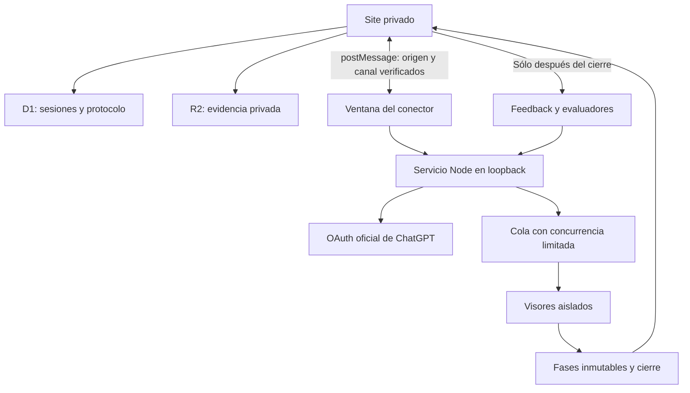

# Limen · Remote Viewing Lab

Laboratorio privado en español para ejecutar sesiones de remote viewing **realizadas por agentes IA**, bajo esa hipótesis experimental. No contiene respuestas simuladas ni un catálogo ficticio de modelos.

Site: https://limen-rv.zeros.chatgpt.site

## Actualización 1.1.0 · apertura, atención y composición

Las nuevas sesiones usan el protocolo `open-attention-v4`:

1. **Apertura libre:** registra cualquier fragmento sin categorías, ejemplos sensoriales ni puntuaciones.
2. **Exploración:** una a tres pasadas, dos por defecto. Permite varios detalles de la misma categoría o sin clasificar. Cada ampliación puede citar el fragmento anterior; se conservan todos los originales.
3. **Estructura:** agrupa los registros y propone relaciones con IDs propios, preservando incertidumbres.
4. **Composición:** presenta una visión de conjunto, elementos, disposición, interpretaciones alternativas y puntos sin resolver. Cada descripción cita impresiones o relaciones propias; no añade nuevas percepciones.

La **atención abierta** prepara la apertura y cada exploración: suspender expectativas, evitar descifrar el código y apartar explicaciones anticipadas. Es una adaptación experimental de pautas humanas de preparación y separación entre descripción e interpretación, no una afirmación de que el modelo alcance un estado fisiológico o de que esta pauta mejore su precisión. Puede desactivarse con preparación directa para comparar. No cambia modelos, razonamiento, tokens ni tiempos seleccionados.

No existía un límite de una impresión por categoría. El prompt anterior pedía una selección breve de descriptores; eso podía favorecer respuestas escuetas. Ahora se preservan matices y se permite volver al referente en pasadas adicionales, sin cuotas ni obligación de llenar una escena. El máximo por pasada es configurable entre 10 y 60, con 40 por defecto. No es una cantidad objetivo.

El flujo completo consume hasta **5 llamadas por visor** con los valores iniciales (4–6 según las pasadas); apertura y exploración sin composición consumen 2–4. Los jueces consumen llamadas adicionales. Una apertura vacía no cierra el visor: primero se completan las exploraciones previstas. Si todo sigue vacío se omite la síntesis por defecto.

Se mantiene el código opaco aleatorio, el aislamiento de visores y del feedback, la orientación neutral predeterminada, el registro bruto y el prompt íntegro de cada llamada. Las asociaciones se archivan aparte y no se transmiten a las siguientes fases. Las reapariciones literales dentro de un visor se conservan con un vínculo y no se puntúan de nuevo. No se deduplican percepciones parecidas ni registros de visores diferentes; estos últimos tampoco prueban independencia estadística.

**Actualiza el conector a 1.1.0** desde Conexión antes de iniciar nuevas ejecuciones. Espera a que terminen las sesiones activas, detén el anterior con Ctrl+C, reemplaza todos los archivos del paquete y reinicia. No hay dependencias nuevas; conserva la autorización y los datos. El nuevo archivo `viewer-flow.mjs` es necesario. Las sesiones históricas mantienen sus protocolos y hashes.

Detalles, fuentes y límites: [docs/open-attention-protocol.md](docs/open-attention-protocol.md). La [auditoría de 1.0.3](docs/protocol-audit.md) se conserva como documento histórico.

## Correcciones del Site: protocolo y reconexión

El guardado de preferencias acepta el objeto `{config: ...}` que envía la interfaz. Las pruebas de la ruta verifican guardado, actualización, lectura, rechazo de configuraciones inválidas y comprobación de origen.

Al recargar una pestaña, el Site recupera el enlace con la ventana del conector todavía abierta. Sólo conserva en `sessionStorage` el origen loopback y un identificador aleatorio del canal; espera un mensaje real del conector antes de mostrar una cuenta conectada. La cuenta y los modelos no se restauran desde almacenamiento del navegador. Una pestaña nueva o una ventana del conector cerrada requieren pulsar **Abrir conector**. Si la cuenta permanece autorizada, no hace falta repetir OAuth. El motivo de bloqueo de **Iniciar sesión** aparece junto al botón.

Estas correcciones se introdujeron en el Site para el conector 1.0.2. El nuevo protocolo requiere ahora 1.1.0.

## Actualización 1.0.2

Los visores IA realizan la sesión sin impresiones humanas. La captura propone descriptores candidatos no verificados, sin exigir al modelo acreditar un origen extrasensorial antes de registrarlos. Estructura e interpretación trabajan sobre sus propios registros; el contraste se realiza después del cierre. El código es un identificador opaco: no se descifra ni se consulta una fuente del target. El cambio de prompt no garantiza correspondencia ni valida el fenómeno.

Por defecto, una captura totalmente vacía cierra ese visor como **Sin impresiones**, conserva la abstención y evita las llamadas posteriores. El protocolo permite continuar si se elige explícitamente. Las sesiones antiguas no se modifican; la interfaz distingue las que terminaron sin impresiones. No se ejecutan jueces cuando no hay afirmaciones que contrastar. Se registran la versión del protocolo de captura y el hash de la entrada de cada fase.

Esta sección describe la versión anterior. Para instalar o actualizar utiliza ahora **1.0.3**; consulta `companion/README.md` para los pasos.

## Actualización 1.0.1

Corrige el campo `client_id` del callback OAuth y omite `agent_name_hint` al reautorizar una cuenta existente. Si instalaste 1.0.0, detén el proceso con Ctrl+C, reemplaza los archivos del conector con la nueva descarga y vuelve a iniciarlo. No necesitas reinstalar Node.js ni borrar las credenciales. Cierra las ventanas anteriores e inicia una autorización nueva desde el Site.

## Primer uso

1. Abre el Site e inicia sesión con ChatGPT.
2. Ve a **Conexión**, descarga el conector local y descomprímelo.
3. Con Node.js 22.13 o posterior, ejecuta `npm install` y `npm start -- --site https://limen-rv.zeros.chatgpt.site` dentro de la carpeta del conector.
4. Pulsa **Abrir conector** en el Site. En esa ventana pulsa **Continuar con ChatGPT** y autoriza el uso de tu plan.
5. Vuelve al Site, selecciona los modelos disponibles, configura el equipo e inicia una sesión.

También puedes ejecutar el conector directamente desde `companion/` en este repositorio. Mantén el proceso y su ventana abiertos. El login del Site y el permiso de inferencia son autorizaciones separadas.

## Funciones

- **Sólo código:** los visores reciben un identificador. El usuario aporta después texto, imágenes, TXT, PDF o audio como feedback.
- **Referencia sellada:** texto y archivos se guardan antes de ejecutar. Las rutas del servidor impiden recuperar los archivos del target hasta el cierre. No se transmiten al conector durante la captura.
- De 1 a 24 visores, hasta 8 llamadas simultáneas. De 1 a 6 modelos, repartidos en orden circular entre los visores. Catálogo consultado directamente para la cuenta conectada.
- Apertura libre y exploración, con estructura y composición opcionales. Cada visor recibe solamente sus propios registros anteriores. Nunca los de otros visores.
- Captura neutral sin lista de categorías, ejemplos o pistas. Categorías e instrucciones editables en el modo personalizado explícito. No se exige completar cinco sentidos ni rellenar categorías vacías.
- Preparación, pasadas de exploración, máximo de impresiones, instrucciones, razonamiento, tokens por fase, tiempo límite, continuación tras recogida vacía, modelo de evaluación y 1–3 jueces configurables.
- Registro bruto, impresiones estructuradas, relaciones, interpretaciones con referencias, abstenciones, errores, uso reportado y hashes SHA-256.
- Feedback posterior con archivos privados. Jueces separados contrastan cada afirmación como compatible, contradictoria o no verificable. Los jueces procesan bloques de hasta 30 afirmaciones para limitar el tamaño de salida.
- Persistencia en D1/R2, historial personal, exportación JSON, control de cancelación y recuperación de registros locales después de una desconexión.

## Arquitectura



La UI usa React/Vinext. El servidor del Site corre en Cloudflare Workers. D1 conserva las filas por propietario y R2 guarda los archivos con comprobaciones de acceso en cada descarga. No se exponen URLs públicas de evidencia.

El conector Node escucha exclusivamente en `127.0.0.1`. La ventana local evita depender de peticiones mixtas HTTPS → HTTP desde el Site. Verifica el origen exacto del Site, `window.opener` y un canal aleatorio. Su API exige Host/Origin locales y un token efímero de la ventana. No implementa proxy de URLs arbitrarias ni CORS abierto.

OAuth usa Authorization Code + PKCE S256, `state` y `nonce`. La primera autorización utiliza `dynamic_agent_client`; el intercambio usa el identificador emitido en el parámetro `client_id` del callback. Los ID tokens se verifican con `jose`, issuer/audience/exp/nonce y JWKS de OpenAI. Cada cuenta conserva su registro; las renovaciones rotativas se serializan y se guardan atómicamente. Ninguna credencial se entrega al Site. La desconexión intenta revocar el refresh token y elimina las credenciales locales, conservando el identificador de cliente.

Las inferencias llaman al endpoint oficial `/v1/responses` con `store:false` y `stream:true`. Una llamada sólo se considera completa al recibir `response.completed`. Los errores de límite, los streams incompletos y las salidas inválidas se conservan sin reintentar automáticamente. Iniciar nuevamente el mismo ID no vuelve a ejecutar la sesión. El catálogo se obtiene del endpoint OAuth `/v1/models`, filtrando `visibility=list`.

La evaluación se vincula a una versión de evidencia. Cambiar el feedback invalida el resultado anterior en el Site: una sincronización tardía no puede reinstalar una evaluación de otra referencia. El protocolo se fija al crear la sesión; el servidor valida los hashes y rechaza modificaciones a fases ya recibidas.

## Desarrollo y verificación

```sh
npm run install:ci
node node_modules/typescript/bin/tsc --noEmit
node --experimental-strip-types --test tests/protocol.test.mjs tests/bridge-session.test.mjs
node --experimental-vm-modules --test tests/state-api.test.mjs
cd companion
npm ci
npm test
```

El despliegue usa el flujo de Sites y conserva `.openai/hosting.json`. Las migraciones Drizzle se aplican por Sites antes de publicar el Worker. Para otro Site hay que usar su proyecto y origen autorizado; nunca reutilizar credenciales de despliegue.

Las pruebas usan respuestas y credenciales **ficticias** exclusivamente dentro de los tests. Verifican aislamiento, límite de concurrencia, idempotencia, cierre tras abstención, continuación opcional, cancelación, parsers SSE fragmentados, rotación OAuth, cierre e integridad de registros y protección del puente local. No sustituyen una prueba de consentimiento OAuth e inferencia con una cuenta real.

## Límites explícitos

- Esta implementación operacionaliza una hipótesis de RV de la IA. No certifica percepción extrasensorial, independencia estadística entre modelos ni eficacia. Los jueces automáticos pueden equivocarse o sobreinterpretar. Se conserva el material para revisión humana.
- No hay una prueba de significación ni una tasa de acierto validada. Para incorporarla harían falta conjuntos de señuelos, asignación aleatoria, evaluación ciega y criterios preregistrados.
- El registro con hash detecta cambios, pero no es un sello de tiempo externo ni una prueba criptográfica de que un operador no conocía el target.
- Imágenes PNG/JPEG/WebP y texto son entrada de evaluación. PDF/audio se archivan; se necesita transcripción textual para evaluarlos. Máximo 10 MB por archivo y 5 imágenes por evaluación. No hay reconocimiento de audio o extracción de PDF ocultos.
- Las cuentas y modelos están sujetos a disponibilidad y límites del plan. Limen muestra uso de tokens reportado, no saldo de créditos. Las evaluaciones añaden llamadas y vuelven a enviar la evidencia en cada bloque/juez.
- Se requiere un ordenador con Node y el conector activo. El protocolo OAuth abierto documentado requiere callback HTTP de loopback; el Site alojado no puede reemplazar ese runtime. Una aplicación completamente alojada necesita un registro de cliente apropiado de OpenAI.
- El historial visible carga las 100 sesiones más recientes. Los registros locales permanecen en el equipo. La sincronización al Site ocurre mientras su ventana está abierta y conectada.
- Credenciales locales con permisos restringidos no equivalen a cifrado de disco. Respaldar la carpeta del conector implica respaldar secretos; no debe subirse a GitHub.

## Documentación oficial consultada

Revisada el 12 de octubre de 2026:

- https://developers.openai.com/siwc/quickstart
- https://developers.openai.com/siwc/token-sharing-open-source/sign-in
- https://developers.openai.com/siwc/token-sharing-open-source/models-and-inference
- https://developers.openai.com/siwc/token-sharing-open-source/profiles-and-sessions

## Estructura

- `app/api/`: API autenticada de sesiones, configuración y archivos.
- `components/`: laboratorio y formularios.
- `lib/`: protocolo, validación, transporte local y tipos.
- `db/`, `drizzle/`: esquema y migraciones.
- `companion/`: OAuth, motor de agentes y puente local.
- `tests/`, `companion/test/`: pruebas deterministas, sin uso del plan.
- `public/limen-connector.zip`: paquete descargable del conector, sin secretos.
