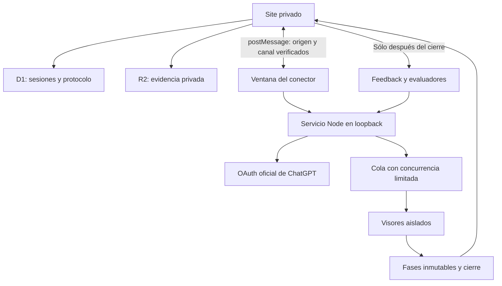

# Limen · Remote Viewing Lab

Laboratorio privado en español para ejecutar sesiones de remote viewing **realizadas por agentes IA**, bajo esa hipótesis experimental. No contiene respuestas simuladas ni un catálogo ficticio de modelos.

Site: https://limen-rv.zeros.chatgpt.site

## Actualización 1.0.1

Corrige el campo `client_id` del callback OAuth y omite `agent_name_hint` al reautorizar una cuenta existente. Si instalaste 1.0.0, detén el proceso con Ctrl+C, reemplaza los archivos del conector con la nueva descarga y vuelve a iniciarlo. No necesitas reinstalar Node.js ni borrar las credenciales. Cierra las ventanas anteriores e inicia una autorización nueva desde el Site.

## Primer uso

1. Abre el Site e inicia sesión con ChatGPT.
2. Ve a **Conexión**, descarga el conector local y descomprímelo.
3. Con Node.js 22.13 o posterior, ejecuta `npm install` y `npm start -- --site https://limen-rv.zeros.chatgpt.site` dentro de la carpeta del conector.
4. Pulsa **Abrir conector** en el Site. En esa ventana pulsa **Continuar con ChatGPT** y autoriza el uso de tu plan.
5. Vuelve al Site, selecciona los modelos disponibles, configura el equipo e inicia una sesión.

También puedes ejecutar el conector directamente desde `companion/` en este repositorio. Mantén el proceso y su ventana abiertos. El login del Site y el permiso de inferencia son autorizaciones separadas.

## Funciones

- **Sólo código:** los visores reciben un identificador. El usuario aporta después texto, imágenes, TXT, PDF o audio como feedback.
- **Referencia sellada:** texto y archivos se guardan antes de ejecutar. Las rutas del servidor impiden recuperar los archivos del target hasta el cierre. No se transmiten al conector durante la captura.
- De 1 a 24 visores, hasta 8 llamadas simultáneas. De 1 a 6 modelos, repartidos en orden circular entre los visores. Catálogo consultado directamente para la cuenta conectada.
- Captura simple o tres fases: captura, estructura e interpretación. Cada visor recibe solamente sus propios registros anteriores. Nunca los de otros visores.
- Categorías abiertas y editables: sensaciones, geometría, textura, movimiento, temporalidad, emoción, presencia y cualquier descriptor nuevo. No se exige completar cinco sentidos ni rellenar categorías vacías.
- Instrucciones, razonamiento, tokens máximos por fase, tiempo límite, modelo de evaluación y 1–3 jueces configurables.
- Registro bruto, impresiones estructuradas, relaciones, interpretaciones con referencias, abstenciones, errores, uso reportado y hashes SHA-256.
- Feedback posterior con archivos privados. Jueces separados contrastan cada afirmación como compatible, contradictoria o no verificable. Los jueces procesan bloques de hasta 30 afirmaciones para limitar el tamaño de salida.
- Persistencia en D1/R2, historial personal, exportación JSON, control de cancelación y recuperación de registros locales después de una desconexión.

## Arquitectura



La UI usa React/Vinext. El servidor del Site corre en Cloudflare Workers. D1 conserva las filas por propietario y R2 guarda los archivos con comprobaciones de acceso en cada descarga. No se exponen URLs públicas de evidencia.

El conector Node escucha exclusivamente en `127.0.0.1`. La ventana local evita depender de peticiones mixtas HTTPS → HTTP desde el Site. Verifica el origen exacto del Site, `window.opener` y un canal aleatorio. Su API exige Host/Origin locales y un token efímero de la ventana. No implementa proxy de URLs arbitrarias ni CORS abierto.

OAuth usa Authorization Code + PKCE S256, `state` y `nonce`. La primera autorización utiliza `dynamic_agent_client`; el intercambio usa el identificador emitido en el parámetro `client_id` del callback. Los ID tokens se verifican con `jose`, issuer/audience/exp/nonce y JWKS de OpenAI. Cada cuenta conserva su registro; las renovaciones rotativas se serializan y se guardan atómicamente. Ninguna credencial se entrega al Site. La desconexión intenta revocar el refresh token y elimina las credenciales locales, conservando el identificador de cliente.

Las inferencias llaman al endpoint oficial `/v1/responses` con `store:false` y `stream:true`. Una llamada sólo se considera completa al recibir `response.completed`. Los errores de límite, los streams incompletos y las salidas inválidas se conservan sin reintentar automáticamente. Iniciar nuevamente el mismo ID no vuelve a ejecutar la sesión. El catálogo se obtiene del endpoint OAuth `/v1/models`, filtrando `visibility=list`.

La evaluación se vincula a una versión de evidencia. Cambiar el feedback invalida el resultado anterior en el Site: una sincronización tardía no puede reinstalar una evaluación de otra referencia. El protocolo se fija al crear la sesión; el servidor valida los hashes y rechaza modificaciones a fases ya recibidas.

## Desarrollo y verificación

```sh
npm run install:ci
node node_modules/typescript/bin/tsc --noEmit
node --experimental-strip-types --test tests/protocol.test.mjs
cd companion
npm ci
npm test
```

El despliegue usa el flujo de Sites y conserva `.openai/hosting.json`. Las migraciones Drizzle se aplican por Sites antes de publicar el Worker. Para otro Site hay que usar su proyecto y origen autorizado; nunca reutilizar credenciales de despliegue.

Las pruebas usan respuestas y credenciales **ficticias** exclusivamente dentro de los tests. Verifican aislamiento, límite de concurrencia, idempotencia, cancelación, parsers SSE fragmentados, rotación OAuth, cierre e integridad de registros y protección del puente local. No sustituyen una prueba de consentimiento OAuth e inferencia con una cuenta real.

## Límites explícitos

- Esta implementación operacionaliza una hipótesis de RV de la IA. No certifica percepción extrasensorial, independencia estadística entre modelos ni eficacia. Los jueces automáticos pueden equivocarse o sobreinterpretar. Se conserva el material para revisión humana.
- No hay una prueba de significación ni una tasa de acierto validada. Para incorporarla harían falta conjuntos de señuelos, asignación aleatoria, evaluación ciega y criterios preregistrados.
- El registro con hash detecta cambios, pero no es un sello de tiempo externo ni una prueba criptográfica de que un operador no conocía el target.
- Imágenes PNG/JPEG/WebP y texto son entrada de evaluación. PDF/audio se archivan; se necesita transcripción textual para evaluarlos. Máximo 10 MB por archivo y 5 imágenes por evaluación. No hay reconocimiento de audio o extracción de PDF ocultos.
- Las cuentas y modelos están sujetos a disponibilidad y límites del plan. Limen muestra uso de tokens reportado, no saldo de créditos. Las evaluaciones añaden llamadas y vuelven a enviar la evidencia en cada bloque/juez.
- Se requiere un ordenador con Node y el conector activo. El protocolo OAuth abierto documentado requiere callback HTTP de loopback; el Site alojado no puede reemplazar ese runtime. Una aplicación completamente alojada necesita un registro de cliente apropiado de OpenAI.
- El historial visible carga las 100 sesiones más recientes. Los registros locales permanecen en el equipo. La sincronización al Site ocurre mientras su ventana está abierta y conectada.
- Credenciales locales con permisos restringidos no equivalen a cifrado de disco. Respaldar la carpeta del conector implica respaldar secretos; no debe subirse a GitHub.

## Documentación oficial consultada

Revisada el 12 de octubre de 2026:

- https://developers.openai.com/siwc/quickstart
- https://developers.openai.com/siwc/token-sharing-open-source/sign-in
- https://developers.openai.com/siwc/token-sharing-open-source/models-and-inference
- https://developers.openai.com/siwc/token-sharing-open-source/profiles-and-sessions

## Estructura

- `app/api/`: API autenticada de sesiones, configuración y archivos.
- `components/`: laboratorio y formularios.
- `lib/`: protocolo, validación, transporte local y tipos.
- `db/`, `drizzle/`: esquema y migraciones.
- `companion/`: OAuth, motor de agentes y puente local.
- `tests/`, `companion/test/`: pruebas deterministas, sin uso del plan.
- `public/limen-connector.zip`: paquete descargable del conector, sin secretos.
